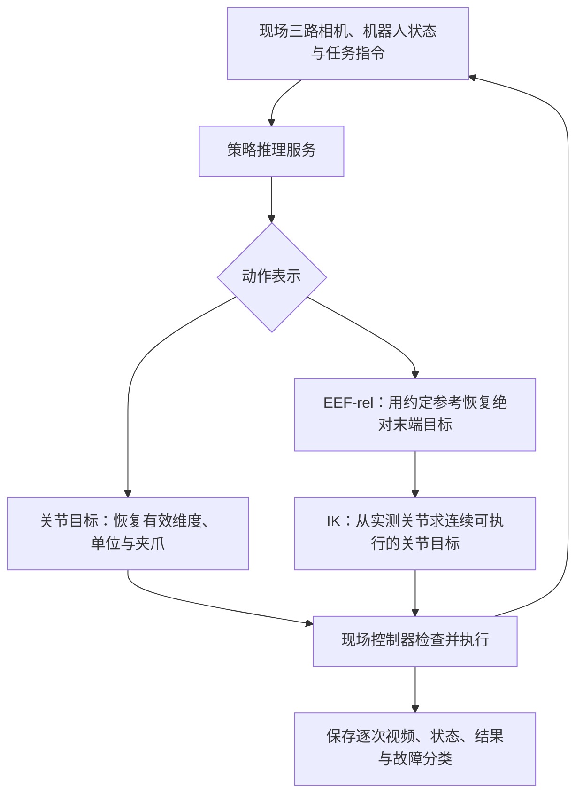

# 双臂 Piper 擦黑板：故障定位、处理与评测复盘

**结论：擦黑板失败可能来自硬件负载、动作语义、逆运动学、接触保持或覆盖轨迹，不能统一归为“策略没学好”。应先处理掉臂和甩臂，再核对相机、夹爪与 EEF-rel 接口，最后恢复同条件闭环评测。** 已有检查表支持相机槽位异常，源码支持连续夹爪目标与动作参考的说明；过热根因、DLS 修复效果和泛化成绩仍缺原始现场证据复核。

本篇合并本次讨论中的现象、原因解释和处理方法。**它是现场材料的整理，不是本仓库新执行的实验，也不是已完成的修复验收。** 月报来自提供的摘录；受限源码、日志与示教仅作只读核对，公开仓库保留文字归纳和元信息，不分发原始材料。依据与核对范围见 [来源说明](#wipe-sources)及 [结构化证据摘要](../resources/blackboard-evidence.json)。

## 先按影响与证据判断

| 问题 | 影响与建议优先级 | 已有证据 | 当前结论 |
|---|---|---|---|
| [WIPE-01 过热、掉臂](#wipe-01) | 高：先恢复可靠保持与硬件状态，再继续评测 | 月报摘录报告相关失分 | 缺温度、故障码、使能及修复前后试次，原因与修复待复核 |
| [WIPE-02 甩臂](#wipe-02) | 高：先定位目标、IK 或执行层的突变 | 月报报告 DLS 修复 | 未取得对应部署分支，不能确认实现与效果 |
| [WIPE-03 求解慢、停顿](#wipe-03) | 影响时限与闭环反馈，先分段计时 | 月报描述；另有后续关节服务的历史计时 | 服务耗时不是该版 IK 耗时，不能混用 |
| [WIPE-04 倾斜时左臂压不住](#wipe-04) | 影响接触与板体稳定 | 月报列为剩余问题 | 尚无失败近景及接触记录，“倾斜”的具体含义未确定 |
| [WIPE-05 右臂死角、擦不净、超时](#wipe-05) | 影响覆盖与完成时间 | 月报列为剩余问题 | “死角”尚未证明是几何不可达 |
| [WIPE-06 相机槽位错位](#wipe-06) | 影响训练输入语义，应按 episode 修正 | 既有逐段表重新统计为 37/70 异常 | 已确认检查表中的异常，未全量复看原视频或验证所有副本已修复 |
| [WIPE-07 夹爪二值化](#wipe-07) | 影响抓取与持续持物，应核对监督语义 | 配置记录原因，构建代码采用连续目标 | 处理路径可核对，本次未重做真机验收 |
| [WIPE-08 EEF-rel 参考与旋转](#wipe-08) | 错误时会改变末端目标，应先离线核对 | 已读该版本的数据与几何实现 | 是明确接口约定，不是已证明的历史故障根因 |

## 机器人、策略与动作表示

本案例使用双臂 Piper：每臂 6 个关节加 1 个夹爪，关节接口共 14 维。材料中的设备 A、B、C 是设备或采集来源代号，不表示 Piper 的三个产品代际；具体子型号、固件与序列号尚未取得。其他协作任务提到 Franka，不能据此认定擦黑板使用 Franka。

| 名称 | 在本案例中的含义 |
|---|---|
| Pi0.5／π0.5 | 策略模型 |
| OpenPI、RLinf | 软件框架；框架名称不能独立确定动作表示或现场版本 |
| 绝对关节策略 | 真实动作是左 6 关节、左夹爪、右 6 关节、右夹爪，共 14 维 |
| EEF-rel 策略 | 每臂位置 3 维、旋转 6 维、夹爪 1 维，双臂共 20 维 |
| 模型宽度 32 | 内部补齐维度，不能直接当作 32 个电机命令 |
| DLS | 阻尼最小二乘逆运动学方法 |
| Pinocchio＋QP | 运动学计算配合另行构造的二次规划与求解器；不是已经验收的后续成果 |

月报摘录报告：设备 A 上的关节混训策略为 **5/10**，主要失分归因为过热掉臂；设备 B 上 EEF-rel 在未见板擦、倾斜黑板和换色板擦场景有成功，同时仍有压持不足、死角与超时。**缺少逐试次记录，不能重判成绩、把所有失败归成同一种原因，或计算各泛化条件的成功率。** 两台设备、两种动作表示也不构成同条件模型对比。

材料中的 87% 参考数据、13% 自采是擦黑板训练样本的混合配置，不是 episode 数量比例，也不是 Pi0.5 全部预训练语料的比例。配置存在不证明训练完成，更不能独立关联到上述评测检查点。

## 从采集到真机评测，流程怎样串起来

下面按已读接口重建系统链路，**不冒充原现场逐步 SOP**。现场客户端源码和原始完整 SOP 尚未取得，后续关节服务也不等同于月报的 EEF-rel 部署版本。

建议按以下顺序准备和验收：

1. 固定设备、检查点、数据版本、归一化统计、动作表示和现场代码版本。
2. 核对三路相机身份、图像与状态时间、左右臂顺序、单位和夹爪量程。
3. 用已有记录离线检查输出维度、反归一化、参考位姿、旋转和动作连续性。
4. 按设备流程检查反馈、起点、运动范围、硬件状态与停止机制，先处理掉臂和突变。
5. 联通服务与现场客户端，分别验收推理返回和物理执行；返回动作不等于任务成功。
6. 记录获取观测、预测一段动作、实际执行其中几步及下一次重规划的时刻。
7. 按预定完成条件和时限逐次判分，保留失败、超时、中止、硬件异常与人工介入。
8. 分开评估原场景、未见板擦、换色、倾斜条件，各自报告成功数、协议分母与全部尝试数。

### SOP 是什么，“任务提采”是什么意思

**SOP 是 Standard Operating Procedure，即标准操作规程。** 对采集，它定义场景、物体、起点、操作者动作、开始结束、合格示范与保存要求；对评测，它还要定义完成状态、擦净范围、残留容许程度、时限、人工介入及故障判分。

“按 SOP 提采”通常指把规范明确的采集需求提交给采集团队，约定条件、数量、字段和质量验收；具体内部流程仍以实际任务单为准。提出需求、采集完成、质检通过和训练有效是四个不同状态。月报报告擦黑板和盖章提采完成，本次未取得任务单、原始 SOP 或验收单，因此不代填其阈值。

可用本仓库的 [采集任务书](../templates/collection-plan.md)、[测评协议](../templates/evaluation-protocol.md)和 [逐次记录](../templates/evaluation-log.csv)承接，但模板本身不证明原任务已经通过验收。

## 定位方法：寻找第一个出错的量

按时间把“模型原始输出 → 反归一化／解码后的目标 → IK 关节目标 → 实际下发命令 → 实测关节和现场结果”对应起来。模型目标已经跳变时先查输入与动作解释；末端目标平滑而 IK 输出跳变时重点查求解；下发平滑而实测异常时重点查控制、负载与反馈。只有最终失败视频，往往不足以定位最早的异常层。

## WIPE-01 电机过热与掉臂

**现象与影响：** 手臂失去可靠保持，干扰任务执行与后续判分，应优先处理。月报把一组失分归因为过热，但缺少对应传感与故障记录。

**原因分析：** 悬持手臂、工具和持续压持都可能要求电机持续输出力矩。几乎不动也会有持续电流和发热；手臂伸得更远通常需要更大重力力矩。单纯降速未必减小静态负载，还可能延长受载时间。不过，“掉臂”也可能来自失能、通信中断、异常退出或其他保护，不能只凭外观确认热保护。

**先查：** 对齐故障前后视频、目标与实测关节、控制状态；驱动支持时保存温度、电流／力矩、故障码和使能。核对是否先出现温升／告警，再失去跟踪；同时检查断连和进程退出的实际副作用。

**处理：** 按型号与现场流程恢复硬件正常状态，核对负载、工具、姿态、持续压持和散热条件；随后再处理增加抖动或负载的目标与控制问题。保留原保护机制，不通过提高保护阈值来“完成评测”。DLS 可能改善某些不良运动，但不是硬件热问题已消除的证据。

**验证与经验总结：** 在可比较的起始温度、工具负载、姿态和任务时长下记录前后结果，检查温度、故障、跟踪误差和掉臂事件。短暂完成一次，不能证明连续运行已恢复可靠性。

**依据与范围：** 月报摘录 F01；发热与失能机制属于通用工程解释。本次没有确认原现场根因或修复验收。对应 [TEL-05](teleoperation-and-actions.md#tel-05)、[EVAL-02～03](evaluation.md#eval-02)。

## WIPE-02 甩臂与 DLS 的作用边界

**现象与影响：** 关节突然大幅运动。先暂停正式评测，并区分模型目标突变、动作转换错误、IK 解跳变和控制跟踪异常。

**原因分析：** 接近奇异位形时，一些末端方向难以通过小幅关节运动实现，直接求逆可能放大小误差。IK 初值、解分支、关节角环绕、限位和单位错误也可能造成突变；“用了 IK”不等于必然平滑。

DLS 通过阻尼抑制放大。一个常见局部形式是：

$$
\Delta q = J^\mathsf{T}(JJ^\mathsf{T}+\lambda^2 I)^{-1}e
$$

其中 `e` 为末端误差，`J` 为雅可比，`λ` 为阻尼。**这是通用原理，不是尚未取得的现场分支实现或参数。**

**先查：** 用同一时间线比较末端目标、IK 输入与输出、下发命令和实测关节，记录每步关节变化、求解状态和初值。若解码前后已出现跳变，先处理动作语义。

**处理：** 核对可靠实测初值、解连续性、关节限制、步长与速度约束，以及不可达／未收敛目标的明确处理。阻尼、约束和失败处置需结合所用求解器实施，不能给所有设备套一个数值。

**验证与经验总结：** 先用相同已记录目标对比关节连续性、末端误差、耗时和求解失败，再按现场条件验证。DLS 不自动保证避碰、限位、连续性或电机不过热。

**依据与范围：** F01 只报告 DLS 已修复若干问题，未取得其部署分支与前后证据；其余为定位建议。对应 [TEL-02](teleoperation-and-actions.md#tel-02)。

## WIPE-03 求解慢、推理慢与动作段停顿

**现象与影响：** 机器人等待、反应滞后或超时，但等待不一定发生在 IK。

**原因分析：** 取图、编解码、网络、预处理、模型、解码、IK、队列与执行都可能贡献延迟。启动预热与稳态运行不同；跨机器未校时的墙上时钟也不能直接相减。

**先查：** 使用请求 ID 和同进程单调时钟拆分各环节；另记观测时刻、动作生成时刻、下发时刻与实际执行步数。对 IK 记录每目标迭代、收敛和耗时，统计中位数与长尾，确认慢目标是否接近不可达、奇异或限位。

受限材料中另有后续**关节动作服务**的历史记录：抽取末尾 45 条请求，均返回 32 步，服务处理为 1125～1323 ms，中位数 1194 ms。该计时包含锁等待与策略调用、不含现场执行，**不是月报那版 DLS 的 IK 耗时**。32 步、每步 1/30 秒约对应 1.07 秒命令时长；实际执行几步、何时发起下一次推理仍要单独确认，不能据这些数字独立判断会否停顿。

**处理：** 瓶颈确在 IK 时，再优化固定计算、对象复用、雅可比、初值与有界求解；瓶颈在模型或传输时，针对该环节处理。异步与动作分段需要同时定义旧结果、衔接、取消和重规划规则。Pinocchio 提供运动学计算，QP 仍要构造目标、约束和失败策略，名称本身不保证更快。

**验证与经验总结：** 固定检查点与现场条件，对比分段延迟、动作年龄、停顿、跟踪误差和时限内完成情况。30 Hz 的动作时间步不意味着大模型必须每秒推理 30 次；预测长度、执行长度与调度频率分别记录。

**依据与范围：** F01 的慢求解陈述及 F02 的另一版本历史服务日志；未重新运行。对应 [RUN-03](training-and-deployment.md#run-03)。

## WIPE-04 倾斜时左臂压不住

**现象与影响：** 板体滑动、接触离开或手臂跟踪不足，都可能被描述成“压不住”，处理方法不同。月报未给出失败近景或具体倾斜方式。

**原因分析：** 如果黑板只在桌面内转斜，板面法向通常不变，但抓持边缘位置、手臂距离与余量会变；如果抬高一边，板面方向、支撑与受力关系也会变化。不能默认“倾斜”就是板面法向改变。工具接触点、姿态、摩擦、板体固定及负载问题均可能表现相似。

本次抽看的另一段平放黑板示教中，左臂固定左上边框，右臂擦拭。这证明该示教的分工，**不能证明月报失败时的抓持姿态、倾斜方式与控制策略相同**。

**先查：** 同步看板体／工具相对滑移、接触间隙、目标与实际关节偏差；区分“位置到达”与“建立并保持有效接触”。有可靠反馈时再结合力、力矩或电流解释，不能把电流直接等同于已标定接触力。

**处理：** 修正板面和工具几何、接触方向、站位与符合评测规则的支撑；硬件与接口确实支持时，再评估有界柔顺或力控制。接口和接触正确后，仍在倾斜条件选择错误动作，才针对该条件补示教或调整策略。

**验证与经验总结：** 明确是哪种倾斜，在相同规则下记录接触保持、滑移、负载、跟踪与结果。一次倾斜成功和某些倾斜条件仍失败可以同时成立。

**依据与范围：** F01 的剩余失分陈述、F03 的另一段示教关键帧；具体失效机制仍待现场证据。对应 [DATA-01](data-quality-and-coverage.md#data-01)、[EVAL-02](evaluation.md#eval-02)。

## WIPE-05 右臂死角、擦不净与超时

**现象与影响：** 边角残留、同一区域反复补擦或最终超时。“死角”是现象名称，尚不能单独证明几何不可达。

**原因分析：** 可达性、连续路径、覆盖范围、真实接触和等待时间都可能造成相似残留，需要逐项区分：

| 可能机制 | 怎样区分 | 相应处理方向 |
|---|---|---|
| 保持擦面方向时不可达 | 带工具姿态和关节限制检查可达性 | 调整规则允许的站位、工具或分工 |
| 单点可达，但路径受限 | 查看连续路径中的限位、碰撞与奇异区 | 处理整段路径，不能只验证一个点 |
| 轨迹没有覆盖残留区 | 把板面残留与实际工具范围叠加 | 调整扫掠、边缘处理与覆盖重叠 |
| 经过了，但擦面没有接触 | 检查实际擦面与板面的相对关系 | 修正工具中心、方向与接触保持 |
| 接触差或工具状态变化 | 看残留变化、滑移与有效清除 | 查工具、压持和重复动作的效果 |
| 时间耗在等待 | 拆分推理、执行和补擦用时 | 优化真实瓶颈，不能只改 IK |

**先查与处理：** 在固定板面坐标下记录残留与实际接触轨迹，先查运动范围和工具几何，再查接触与覆盖，最后按缺失区域补数据。末端位置投影经过板面，不代表擦面已经贴住。改变板体位置、支架或左右分工需符合原规则并单独留版本。

**验证与经验总结：** 使用相同擦净标准和时限，对比残留、有效覆盖、重复动作、分段用时及全部试次。默默延长时限或缩小板面，会破坏修复前后的可比性。

**依据与范围：** F01 只记录现象，未取得残留图与轨迹；表中为候选机制和排查建议。对应 [DATA-01～03](data-quality-and-coverage.md)、[EVAL-01～02](evaluation.md#eval-01)。

## WIPE-06 相机错位：为什么好像是“中途才错”

**现象与影响：** 一部分数据的主视角、左腕和右腕进入了错误槽位。同一个输入槽位对应不同视角，会给视觉条件与动作关系引入冲突。

**已有定位证据：** 既有脚本选取人工确认正确的参考 episode，比较三路首帧的灰度特征，枚举六种排列，并用最佳与次佳差值提示人工复核。实现使用 16×32 特征网格，主视角看全图，腕部主要利用底部较稳定的外观。既有逐段表被重新统计为：0831 批次 70 段中 **37 段 `ROTATED`、33 段正常**。这次核对了统计和已有对比图，没有重新全量审片。

| 原始键名 | 异常 episode 中实际视角 |
|---|---|
| `cam_head_0` | 左腕 |
| `cam_wrist_left` | 右腕 |
| `cam_wrist_right` | 主视角 |

`ROTATED` 指三个槽位循环错位，**不是图像在平面内旋转**。异常索引为 0～29、32、43、54、65、67、68、69，不能简化为“前 37 段”。另一批 0901 的 133/133 被表格标为正常，只说明该项相机顺序检查结果。

**原因分析：** 不同 episode 的槽位不同，不等于同一条录像在半途中突然换了视角。采集节点重启、设备重新枚举、批次配置或导出绑定改变都是候选原因，需要批次日志验证；现有证据没有确认具体触发原因。物理支架移动又是另一类问题。

**处理：** 给受影响 episode 保存显式映射；恢复“主、左腕、右腕”时，分别使用“原右腕键、原头部键、原左腕键”。正常 33 段保持原映射。随后重建相应导出、缓存、训练清单并追踪受影响检查点；改正文件不会自动改正已训练模型。

**验证与经验总结：** 对正常与异常样本、源数据与导出数据分别回读，覆盖同条轨迹多个时刻。首帧视角正确不证明全片映射稳定，也不证明三路相机物理同步。现有多时刻检查脚本存在，不等于本次已全量执行。

**依据与范围：** F02 的只读源码、逐段表与既有对比图；公开摘要不包含原始视频或逐段原表。对应 [IO-01](capture-and-storage.md#io-01)、[CAM-03](camera-and-calibration.md#cam-03)、[RUN-02](training-and-deployment.md#run-02)。

## WIPE-07 夹爪二值化、0/1 还原与补救

**现象与影响：** 想继续夹住板擦，处理后的目标却可能成为全开。需要把“操作者的命令”“从手实际开度”“训练目标”分开。

**原因分析：** 主手表达控制意图，从手执行并反馈。板擦挡在两指之间时，即使仍在要求夹紧，实际开度也不必接近零。配置说明记录的约 **0.053 m** 是这种实测状态；旧二值阈值为 **0.025 m**。**不能据此断言实现直接把 0.053 m 当作 Piper 动作目标。** 已读构建代码中，状态来自从手夹爪反馈，Piper 目标夹爪来自主手命令；关节目标则采用未来从手关节状态。

### 0/1 是怎样变回物理开度的

以下说明该案例的开度映射，其他系统的 0／1 含义可能相反，必须查实际代码。模型额外使用的训练标准化也要先正确逆变换。

| 处理 | 编码 | 恢复到物理目标 |
|---|---|---|
| 旧宽度阈值二值化 | 低于阈值记 0，否则记 1 | 若 0 为全合、1 为全开，按端点恢复；阈值区间中的原始宽度已经丢失 |
| 连续开度映射 | `u = clip((w - w_min) / (w_max - w_min), 0, 1)` | `w = w_min + clip(u, 0, 1) × (w_max - w_min)`，保留量程内的中间目标 |

该实现会裁剪越界值，越界前的原始数值也不能靠逆映射找回，因此原始命令仍需保留。

一个**说明性例子，不是现场测量**：假设主手目标为 0.040 m，旧映射得到 `0.040 ≥ 0.025 → 1`，再按该 Piper 配置的 0.074 m 端点恢复，就变成全开。连续映射得到 `0.040 / 0.074 ≈ 0.54`，恢复后仍为 0.040 m。

这份配置对 Piper 自采和 Table30 来源分别使用 0.074 m、0.107 m 量程。这是来源配置值，不是所有硬件、固件与夹爪指尖的通用行程；跨来源混训应各自编码，部署再按目标设备正确还原。

**先查：** 同一持物时段逐层对照“主手命令 → 从手开度 → 转换后监督 → 模型输出 → 最终物理命令”。若监督已变成全开，先修标签；若标签正确而模型输出错误，再查输入与模型。往返转换正确只说明映射自洽，不证明原始语义正确或夹持力足够。

### 标签已经只剩 0/1，怎么办

1. 原始连续命令仍在：回到原始来源，按来源量程重建目标、导出与缓存，重新计算匹配的归一化统计。
2. 只剩二值标签且原始命令丢失：不能准确逆推出每个中间宽度，应寻找备份或重采。视频重标是新标签，不能冒充原始实测命令。
3. 模型已用错误目标训练：用修正数据和匹配统计重训或微调，再验证抓取、保持与释放。不能把全部输出 1 改成同一个中间宽度，就宣称恢复了不同控制意图。

**处理、验证与经验总结：** 这份代码已采用连续目标来避免上述语义压缩；本次没有重新训练或真机验收。正确的二值开／合命令本身可以适用，问题在于宽度阈值是否忠实表达任务意图。持物掉落与整臂失去保持也不能混为同一个“掉臂”。

**依据与范围：** F02 的配置说明与目标构建实现；例子为解释用途。对应 [TEL-03](teleoperation-and-actions.md#tel-03)、[RUN-02](training-and-deployment.md#run-02)。

## WIPE-08 EEF-rel 的参考、旋转与状态来源

**现象与影响：** 相对动作若按另一种规则解码，数值看似正常，物理目标却会漂移或跳变。以下是已读版本的接口，不是所有叫 EEF-rel 的系统都通用。

**原因分析与接口约定：** 输入状态为上一条命令 `a[t-1]`，预测目标为 `a[t:t+H]`。同一预测段的所有目标都相对同一参考位姿，平移在参考局部坐标系表达；不是把每步位移逐步累加。夹爪仍为绝对量。解码规则改变会让相同预测对应另一条物理轨迹。

仅用一维位置说明：参考 100，相对目标 `[1, 2, 3]` 应恢复为 `[101, 102, 103]`；误作累计会得到 `[101, 103, 106]`。数字只是说明，省略了旋转和单位。

旋转采用 `R[:, :2].reshape(6)`，即前两列按行交错展开，不等于先完整第一列再完整第二列。两种都被称作 rot6d，不代表能互换。双臂有效动作是 20 维，补齐到 32 后，padding 不能当作真实执行量。

**先查与处理：** 用已有记录检查“绝对 → 相对 → 绝对”能否恢复位置与旋转，同时用已知方向样例核对坐标轴，避免编码器与解码器一起错却互相抵消。核对未归一化参考、左右顺序、米／弧度、旋转排列、每段参考更新及部分执行的记账。原现场客户端未取得，不能代填其更新实现。

策略参考用于解释预测，IK 初值用于从实际机器人姿态开始求解；前者是上一条命令，并不意味着后者应忽略实测关节与跟踪误差。

**验证与经验总结：** 覆盖旋转、平移、双臂、夹爪与分段执行，再检查恢复目标和关节解的连续性。“相对动作”这个名称本身不保证训练与部署契约一致。

**依据与范围：** F02 的数据窗口、输入检查和位姿编码实现；未把它认定为月报已发生故障。对应 [RUN-02](training-and-deployment.md#run-02)。

## 已有质检日志可以证明什么

下表来自受限材料中后续数据流水线的既有检查，本次只读，**没有重新运行**，也不是月报真机试次的验证。部分统计包含旧导出目录，不能拿来代替正式训练集规模。

| 检查 | 历史记录与范围 | 不能扩大成的结论 |
|---|---|---|
| 源列重建标签与导出对比 | 119,889 帧，最大差值 0，包含旧目录 | 构建规则本身正确、全部源数据正确或正式训练集有这么多唯一帧 |
| 导出时间结构 | 501 个视频，表步长最大误差约 3.31 微秒，包含旧目录 | 三台相机在物理采集时同步 |
| 源帧与相邻帧比较 | 三来源运动帧抽样 0/612、0/1188、0/3562 更接近相邻帧 | 全部帧与所有传感器都不存在错时 |
| 帧偏移扫描 | 各来源所检前两个导出 episode、三视角最佳偏移为 0 | 全量 episode 已扫描；静止画面能可靠区分错位 |
| 读取与动作往返 | 2 批各 8 个窗口，最大误差约 1.19×10⁻⁷ | 模型准确、语义必然正确或全量质检通过 |
| 服务离线对照工具 | 源码存在，可对比动作误差、首步跳变、静止基线和耗时 | 工具已经执行且指标已通过 |

**经验结论：导出与源文件一致，不证明源文件原本同步；归一化能往返，不证明监督目标正确；检查脚本存在，不证明它跑过。**

## 擦黑板是 RoboDojo 任务吗，成功录像长什么样

截至 2026-10-29，[RoboDojo 官方真机任务文档](https://robodojo-benchmark.com/doc/real-tasks/)公开 18 项任务，Piper X、Piper、ARX X5 各 6 项，**没有擦黑板**。本案例工程使用 RoboDojo-real 数据接口，只能说明接口关联；是否属于历史、未公开或内部扩展任务，仍无正式说明。不能将 Table30 参考来源自动称为 RoboDojo 官方收录。

本次找到一段训练数据中的 Piper 示教，约 20.27 秒，30 帧/秒，预处理画面为 256×256；抽看了 0、3、6、9、12、15、18、20 秒关键帧，**没有作为连续全片或逐次评测审片**。画面显示：

1. 小黑板平放桌面，中间有粉笔线，蓝色板擦在右侧。
2. 左臂固定左上边框，右臂取板擦擦拭，左臂持续稳定板体。
3. 末尾板擦回到右侧、双臂撤回，主要粉笔线被擦去，仍有淡白痕。

这是对动作分工的观察，没有核实到任务成功标签，也未对应月报的策略检查点、试次或自主运行记录。它不能证明 5/10、倾斜或未见板擦泛化成绩。是否算成功还要依原 SOP 的残留和时限判定；数据导出的 `ok` 也只表示导出完成。

原始示教的公开许可未确认，本仓库只保留观察文字与核对深度，不附原片、截图或受限下载链接。学习公开视频的入口见 [视频资料](../resources/videos.md)，其硬件和证据范围另行注明。

## 来源、适用范围与继续补证

| 来源编号 | 核对范围 | 公开状态与限制 |
|---|---|---|
| F01 | 用户提供的月报摘录：任务目标、5/10、泛化成功案例、剩余问题、DLS 修复和后续计划 | 未独立读取完整原文；没有原始 SOP、逐次表、失败原片或部署分支；仅发布文字归纳 |
| F02 | 授权只读核对的任务配置、标签构建、相机逐段表、EEF-rel 实现和历史日志 | 原始材料不随公开仓库分发；读者无法仅据本仓库独立审计；源码事实、注释和旧日志分别陈述 |
| F03 | 一段 Piper 训练示教的元信息及八个时刻关键帧 | 未确认成功标签、动作来源控制记录或公开许可；不能当作已核实的自主评测成功片 |
| D03 | [RoboDojo 官方真机任务文档](../resources/articles-and-code.md#d03) | 公开原文已核对；结论限于当日公开列表，不排除历史与未公开集合 |

详细元信息见 [sources.json](../resources/sources.json)和 [blackboard-evidence.json](../resources/blackboard-evidence.json)。本篇保留方法与结论边界，不构成原团队所有操作步骤的复述。

继续补证时，优先关联原 SOP 与具体倾斜定义、失败视频与同步状态、温度／故障／使能、模型及现场提交、原始连续夹爪命令、修复前后全部试次。按同条件恢复评测后，再更新已解决状态和适用范围。
