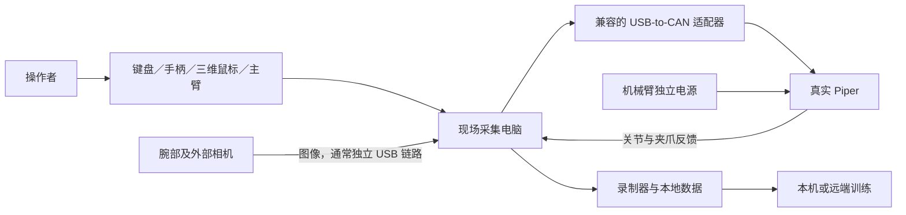

# Piper 入门：先看懂设备与链路

有一台 Piper 和一个采集脚本，还需要匹配的驱动、控制连接、相机、遥操输入、动作适配和任务录制配置。Linux 采集电脑通常就是现场安装 Linux 的实体电脑，不是“必须再装一台虚拟机”。

## 各设备怎样连接

图中是常见结构，具体接口以型号和厂商文档为准：

| 连接 | 作用 | 容易误解的地方 |
|---|---|---|
| 电脑→USB-to-CAN→机械臂 CAN | 控制命令与反馈 | 适配器做通信转换，不是直接给机械臂供电 |
| 相机→电脑 | 图像采集 | 装在手腕上的相机仍需有效数据连接；线缆可能已由套件整理或转接 |
| 输入设备→电脑 | 操作者的控制意图 | 普通鼠标、SpaceMouse、手柄和主臂不是同一类输入 |
| 电源→机械臂 | 给本体供电 | 不能只数“电脑上有几条线”就推断接线已经完成 |

所以不能简单回答“一根还是两根线”。有时多个 USB 设备经过 Hub 接电脑，但机械臂控制、相机图像和机械臂供电仍是不同链路；Hub 的共享带宽也要检查。

采集主要在能访问实际设备的现场电脑上进行。训练可以使用远端服务器，远端服务器不会自动获得现场 USB／CAN 访问能力。虚拟机不是前提；采用虚拟机时还需要验证设备透传和时序，不应把它当作默认方案。

## 腕部已经有相机，为什么还要配置

“相机标识”用于告诉程序哪台设备对应哪个图像键，例如腕部视角和桌面视角；“视角”是相机能看到的内容及其安装关系。硬件上存在相机，不代表软件已经打开了正确设备。

腕部相机随手臂运动正常，关键是相机相对手腕的固定关系。外部相机通常用来观察工位全局，是否需要由遮挡与任务阶段决定，不是所有任务都必须增加相机。

先确认真实预览，再检查最终保存和送入模型的裁剪／缩放图像；细节见 [CAM-01～05](camera-and-calibration.md)。

## 人怎样用“鼠标”控制真实机器人

| 输入方式 | 人怎么操作 | 需要的软件映射 |
|---|---|---|
| 普通鼠标＋键盘 | 鼠标提供二维变化，按键选择轴、模式或夹爪 | 输入状态、平移／旋转／关节映射、目标更新与约束 |
| SpaceMouse 三维鼠标 | 推拉、升降、扭转帽状控制器 | 六自由度意图到机器人动作的适配 |
| 游戏手柄 | 摇杆、扳机、按钮 | 每个轴和按钮的模式与动作含义 |
| 兼容主臂／GELLO | 操作者移动主臂，机器人跟随 | 关节布局、零位、方向、夹爪与初始化对齐 |

操作者可以看真实工位或真实相机画面，不要求先在仿真中采集。屏幕上的三维机器人也可能只是状态显示。仿真可用于开发验证，仿真图像和状态则属于仿真数据。

适配不等于逆动力学。末端位姿意图转成关节位置目标通常涉及逆运动学；直接主从关节跟随则重点在布局和标定映射。见 [TEL-02](teleoperation-and-actions.md#tel-02)。

## 开始与成功键是不是键盘上的

可以是键盘，也可以是手柄按钮或界面控件，完全取决于实际录制器。必须核对启动模式与事件处理代码，不能把教程按键照搬到另一套系统。

一条示范应能区分：准备完成→开始录制→遥操执行→成功／失败／中止→保存完成→复位。停止录制与机械臂停止分别定义。

例如 [Piper 手柄教程](../resources/articles-and-code.md#d02)里的 START 表示模式切换，A 表示位置保存；这不能证明其已接通某个数据录制器的开始或成功事件。

## RLinf 开源了，还需要什么

本仓库参考固定提交 [91a302e](https://github.com/RLinf/RLinf/tree/91a302ec50ddacd1fdabc5859b85e3661d768236)，不将其当作当前最新版或承诺兼容所有 Piper。核对的公开文件列在 [源码清单](../resources/rlinf-source-manifest.json)。

| 层次 | 该快照可以参考的部分 | 仍需完成／确认 |
|---|---|---|
| 驱动与反馈 | Piper 关节／夹爪接口 | 型号、固件、SDK、CAN 适配器兼容性 |
| 环境动作 | 该版带夹爪环境接受 6 个绝对关节弧度目标＋1 个开度比例 | 遥操输入必须转换成同一语义 |
| 遥操 | 通用遥操框架 | 该版 Piper 的 `TELEOP = ()`，示例为 `teleop: none`，不能只把设备名改成鼠标就用 |
| 录制 | 通用 episode 与导出机制 | Piper 字段、时间配对、输出格式、结果与边界 |
| 任务 | Reach 等基础环境接口 | 真实任务的起点、复位、成功条件；关节到位不等于完成抓放 |
| 模型与部署 | 通用训练框架 | 数据转换、归一化、动作重建及真机评测 |

该快照环境初始化会涉及复位目标；不要把默认零关节向量理解为静止。正式接设备前核对连接、复位、输入失效和退出的实际行为。本仓库没有在 Piper 上运行或验证这些代码。

社区 [Gamepad_PiPER](../resources/articles-and-code.md#c01)与 [lerobot_piper](../resources/articles-and-code.md#c02)可以提供适配线索，尚未验证它们与上述 RLinf 快照的兼容性。官方驱动入口见 [pyAgxArm](../resources/articles-and-code.md#c04)。

开始动手时按 [全流程](workflow.md)逐阶段取得可检查产物，不需要先把不相关硬件的全部定制代码搬进来。
