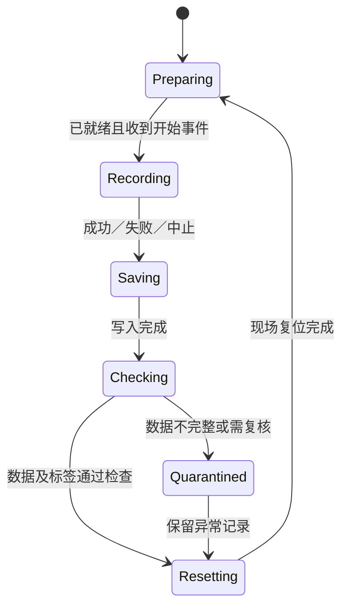

# 从第一次示范到真机测评

每个阶段都留下能检查的产物，先完成一个小范围的闭环，再扩量与扩任务。下面是工作流程，不是可直接控制任意 Piper 的启动脚本。

| 阶段 | 做什么 | 可以进入下一阶段的依据 |
|---|---|---|
| 1. 定义任务 | 明确对象、部署范围、成功／失败、介入和复位 | 完整 [采集任务书](../templates/collection-plan.md)及初版 [测评协议](../templates/evaluation-protocol.md) |
| 2. 固定现场配置 | 确认机器人、夹爪、固件、驱动、CAN、相机和输入设备 | 配置、装配照片、标定标识；反馈与视角核对记录 |
| 3. 接通遥操与事件 | 统一动作语义、输入有效性、保持、复位、开始和结束 | 输入到动作映射及状态转换已验证；不是仅能打开程序 |
| 4. 试采与回读 | 录少量短轨迹，退出后重新打开 | 图像、状态、下发动作、时间、夹爪、结果和尾部完整 |
| 5. 正式采集与质检 | 按条件分批采集，持续检查有效量和异常 | 数据清单、覆盖矩阵、有效／剔除依据与原始记录 |
| 6. 转换与切分 | 核对字段、单位、参考系、mask、归一化 | 可追溯数据版本，按泛化目标划分训练／开发／最终测试 |
| 7. 训练与选型 | 固定基线，记录正式训练和开发评测 | 代码、配置、实际日志、统计量与检查点关联 |
| 8. 部署联调 | 用相同预处理与动作重建接到真实系统 | 部署字段与延迟检查，区分回放和自主运行 |
| 9. 独立真机测评 | 按预定义条件执行多次测试 | 完整逐次记录、视频／日志、分条件结果和限制 |
| 10. 针对失败迭代 | 定位感知、接近、接触、释放、恢复等阶段 | 在开发条件上补采或改方法，保留新的最终验收独立性 |

## 每条采集轨迹的操作顺序

1. 按计划摆放物体，确认设备正常，记录条件 ID，机器人处于约定起点。
2. 触发已核对的开始事件。准备与摆放过程是否录入，由任务规范明确。
3. 用选定输入设备遥操完成任务，录制器同时保存对应观测、实测状态与下发动作。
4. 按真实结果标记成功、失败或中止；成功后保留任务要求的观察证据。
5. 等保存完成，检查本条可读取、标签及条件正确，再复位进入下一条。

录制状态可用下面的状态图理解；它描述需求，不指定键盘或手柄的实际键位。

## 多任务怎样计数

先在 [benchmark 台账](../templates/benchmark-register.csv)定义独立任务／协议及闭环完成标准，再跟踪各阶段。任务只是启动、权重刚保存或只有一次展示视频，都不足以证明完整闭环已完成。

计划数量、实际有效数据、训练完成、正式评测完成、结论可复核应分开报告。台账初始只有表头，不代表已经完成任何 benchmark。

## 监控和归档

实际任务应提供团队可访问且有真实数据的监控入口，显示当前阶段与等待状态；采集、训练和评测日志分别关联实验 ID。监控不能替代数据回读或逐次视频。

每批至少保留：任务与条件、设备／装配／标定、代码／依赖、原始数据清单、转换及统计量、检查点、部署版本、协议与结果。公共仓库只放适合公开的文档和引用，数据与权重可通过有权限的独立存储管理。
